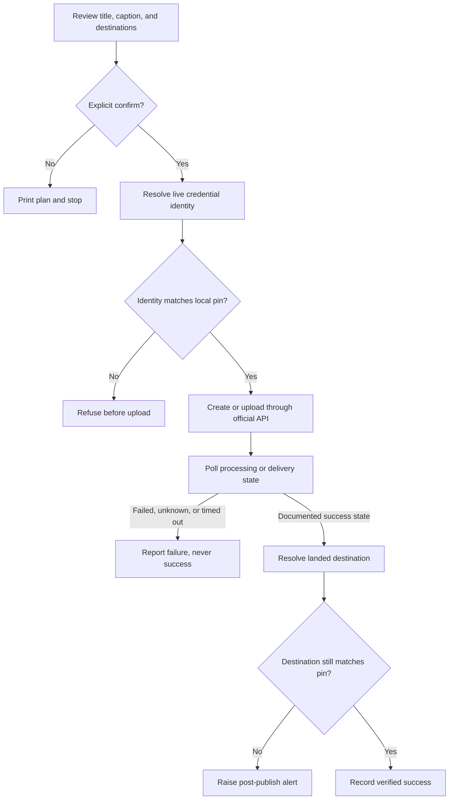

# Social Reel Publisher

Publish one reviewed vertical video to YouTube Shorts, Instagram Reels, and TikTok drafts through official APIs, with account pinning before and after every post.

## Why I built it

I wanted one publishing workflow without giving an unofficial tool access to social accounts. The code spends most of its effort proving which account a credential selected, waiting for asynchronous delivery to finish, and refusing to treat an accepted request as a successful post.

## How it works



- YouTube uploads the local MP4, polls video processing to `succeeded`, checks the returned channel ID, and verifies requested privacy.
- Instagram creates a Reel container from a public URL, polls it to `FINISHED`, publishes it, and checks the media owner against the authorized account.
- TikTok sends a public URL to the creator inbox, polls until `SEND_TO_USER_INBOX` or `PUBLISH_COMPLETE`, then resolves the token identity again. The creator can add licensed audio and post from the app.
- A review-only run is the default. Live API writes require `--confirm`.

## Guardrails

- Destination pins are separate from OAuth token files. A token refresh cannot silently rewrite its own allowlist.
- Missing, unreadable, and mismatched pins fail closed before any upload begins.
- Every selected platform passes a batch preflight before the first upload, then passes another identity check immediately before its own upload.
- Account identity comes from each platform API, not from a user-supplied label.
- An HTTP 200 response is only acceptance. Each asynchronous workflow must reach a documented terminal success state.
- The destination is checked again after processing. A postflight mismatch is an alert, even if the content is already live.
- TikTok token refresh preserves the original authorization timestamp so the annual reauthorization deadline cannot slide forward.
- Credentials live in a brand-specific directory outside source control, and secret-bearing API responses are never printed.
- The included mock test proves that a token for the wrong account makes zero upload calls.

## Quick start

Run the complete offline demo first. It needs no API keys and makes no network calls.

```bash
python3 -m reel_publisher --dry-run
```

Run the tests offline:

```bash
python3 -m pytest
```

For live use, install dependencies and create a local config:

```bash
python3 -m venv .venv
source .venv/bin/activate
python3 -m pip install -r requirements.txt
cp config.example.json config.json
export SOCIAL_PUBLISHER_SECRETS_DIR="$PWD/.local-secrets/example-brand"
```

Complete the OAuth steps in [SETUP.md](SETUP.md), then pin each resolved destination explicitly:

```bash
python3 -m reel_publisher --config config.json --pin youtube
python3 -m reel_publisher --config config.json --pin instagram
python3 -m reel_publisher --config config.json --pin tiktok
python3 -m reel_publisher --config config.json --verify
```

Review a real publish plan. This command does not post:

```bash
python3 -m reel_publisher \
  --config config.json \
  --file media/final-reel.mp4 \
  --url https://media.example.com/final-reel.mp4 \
  --title "A clearer patient check-in" \
  --caption "Three small changes that reduce front desk friction. #Operations"
```

After reviewing the plan, rerun the command with `--confirm`. YouTube needs `--file`. Instagram and the TikTok URL pull flow need `--url`.

## Example output

```text
DRY RUN: mocked happy path
[youtube] PRECHECK matched Northwind Dental [yt-northwind-demo]
[youtube] MOCK HTTP 200 returned an id
[youtube] ACCEPTED video-demo-001 state=ACCEPTED; not claiming success yet
[youtube] POLL state=processing
[youtube] POLL state=succeeded
[youtube] POSTCHECK matched Northwind Dental [yt-northwind-demo]
[youtube] OK video-demo-001 terminal=succeeded
...
DRY RUN: mocked wrong-account refusal
youtube: REFUSED before upload. Token resolves to Jamie Rivera [yt-jamie-personal-demo], but the pin is Northwind Dental [yt-northwind-demo]
[youtube] PASS no upload call was made
```

All names, IDs, URLs, and responses in the demo are fictional fixtures.

## Tech

- Python 3.9+
- YouTube Data API v3 with Google OAuth
- Instagram API with Instagram Login
- TikTok Content Posting API with OAuth and PKCE
- Requests, Google API Client, and pytest

## License

MIT. Copyright (c) 2026 Christian Terrone.
